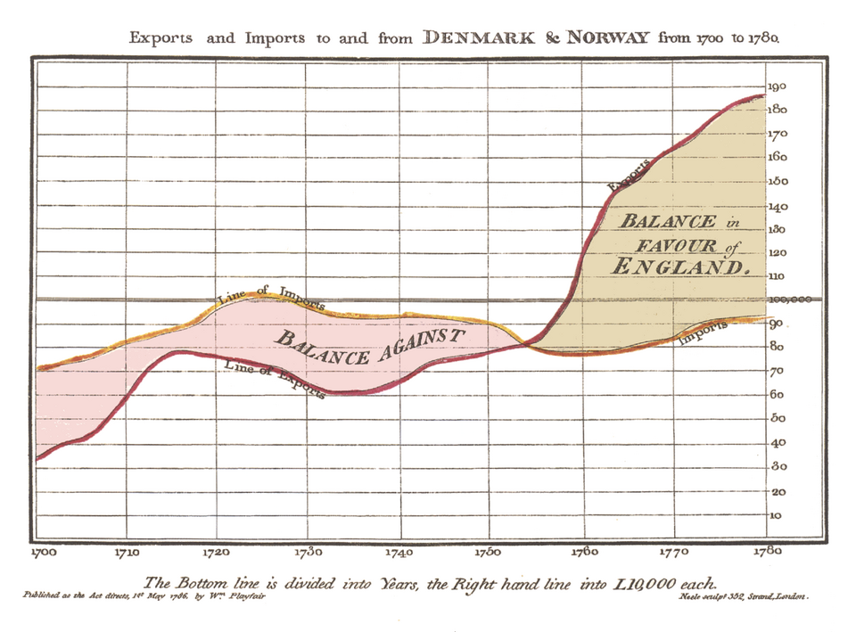
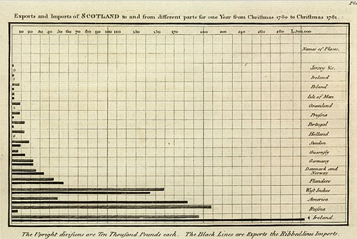
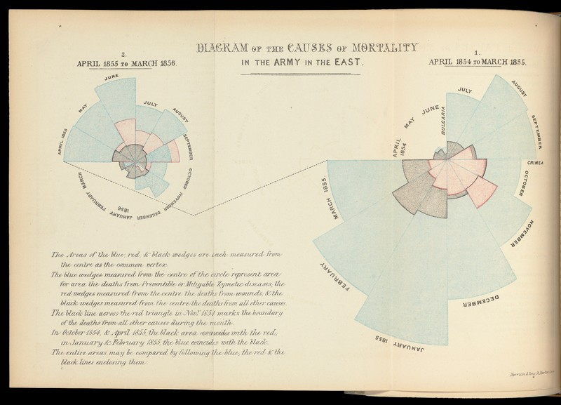
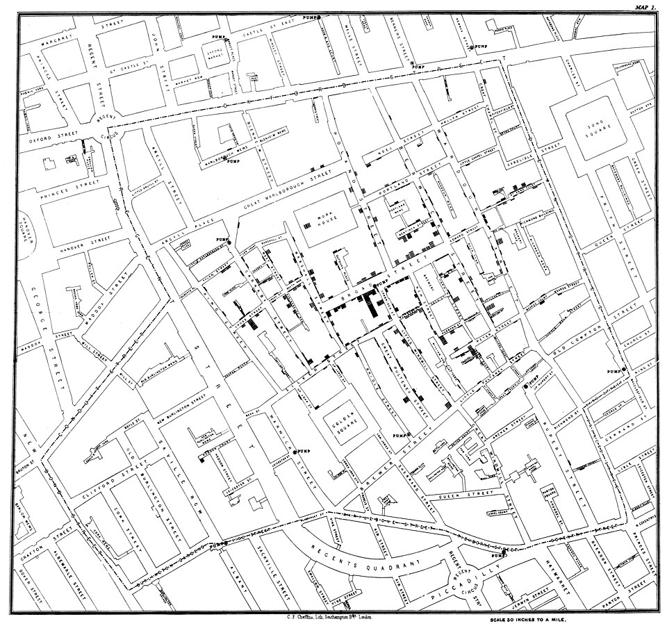
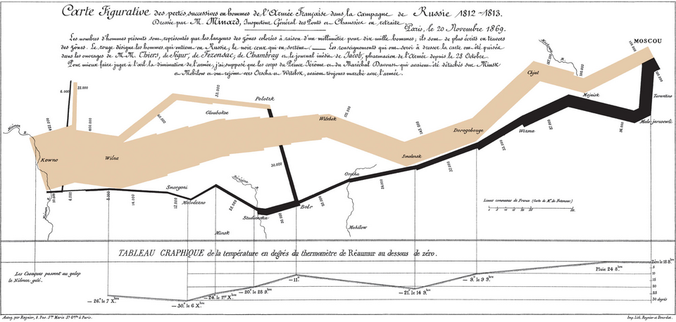

```{r setup, include=FALSE}
knitr::opts_chunk$set(echo = FALSE, warning = FALSE, message = FALSE)
```

## Overview

This document presents four foundational examples in the history of data
visualization, featuring pioneering work by William Playfair, Florence
Nightingale, John Snow, and Charles Minard. These visualizations
established core principles still used in modern statistical graphics.

------------------------------------------------------------------------

## William Playfair (1759–1823): Bar Charts and Line Charts

Playfair is widely regarded as the inventor of modern statistical
graphics. His 1786 *Commercial and Political Atlas* introduced both the
line chart and the first known bar chart. [^1][^2][^3]

[^1]: History of Information. "William Playfair Founds Statistical
    Graphics." Available at:
    <https://www.historyofinformation.com/detail.php?entryid=2929>

[^2]: Open Culture. "The Pioneering Data Visualizations of William
    Playfair." 2023. Available at:
    <https://www.openculture.com/2023/05/the-pioneering-data-visualizations-of-william-playfair-who-invented-the-line-bar-and-pie-charts-circa-1786.html>

[^3]: Wikipedia. "William Playfair." Available at:
    <https://en.wikipedia.org/wiki/William_Playfair>

### Line Chart Example

(1786) A time-series plot showing England's exports and imports to and
       from Denmark & Norway from 1700 to 1780. The area between the two
       lines is shaded to show the balance of trade ("Balance in Favour
       of England" vs. "Balance Again



**Key features:** - Two time series plotted on the same axes - Shaded
area between lines to visualize trade balance - X-axis: years
(1700–1780) - Y-axis: monetary value (imports/exports)

### Bar Chart Example

(1786) A horizontal bar chart showing Scotland's exports (solid black
       bars) and imports (ribbed bars) to and from 17 different trading
       partners for the year Christmas 1780 to Christmas 1781. This is
       considered the first quantitative graphical form that did not
       locate data in space or time. [^4][^5][^6]

[^4]: History of Information. "William Playfair Founds Statistical
    Graphics." Available at:
    <https://www.historyofinformation.com/detail.php?entryid=2929>

[^5]: Friendly, M. "The Big Bang: William Playfair, the Father of Modern
    Graphics." Available at:
    <https://friendly.github.io/HistDataVis/ch05-playfair.html>

[^6]: Conversable Economist. "William Playfair: Inventor of the Bar
    Graph, Line Graph, and Pie Chart." 2017. Available at:
    <https://conversableeconomist.blogspot.com/2017/08/william-playfair-inventor-of-bar-graph.html>



**Key features:** - Horizontal bars for categorical comparison - Paired
bars for exports vs. imports - 17 trading partners on the y-axis -
Monetary values on the x-axis

### Resources

- [Wikipedia: William
  Playfair](https://en.wikipedia.org/wiki/William_Playfair)
- [The Pioneering Data Visualizations of William
  Playfair](https://www.openculture.com/2023/05/the-pioneering-data-visualizations-of-william-playfair-who-invented-the-line-bar-and-pie-charts-circa-1786.html)
- [Gallery of Data Visualization - Historical
  Milestones](http://euclid.psych.yorku.ca/SCS/Gallery/historical.html)
- [Lehigh Library Exhibits: Playfair's Pie
  Chart](https://exhibits.lib.lehigh.edu/exhibits/show/data_visualization/case_one/playfair)

------------------------------------------------------------------------

## Florence Nightingale (1820–1910): Polar Area Diagrams

Nightingale developed the polar area diagram (also called the "coxcomb"
or "Nightingale rose diagram") to communicate mortality data from the
Crimean War (1853–56). [^7][^8][^9]

[^7]: Lehigh Library Exhibits. "Nightingale's Rose Diagram." Available
    at:
    <https://exhibits.lib.lehigh.edu/exhibits/show/data_visualization/science/nightingale>

[^8]: Wikimedia Commons. "Nightingale Rose Chart." Available at:
    <https://commons.wikimedia.org/wiki/File:Nightingale_Rose_Chart.png>

[^9]: Protovis. "Nightingale's Rose." Available at:
    <https://mbostock.github.io/protovis/ex/crimea-rose.html>



### Structure

- A circle divided into 12 equal-angle wedges (one per month)
- The **area** of each wedge (not just the radius) is proportional to
  the mortality rate
- Each wedge is color-coded:
  - **Blue**: deaths from preventable diseases
  - **Red**: deaths from wounds
  - **Black**: deaths from other causes

### Purpose

To show that most deaths were from preventable diseases and that
mortality dropped dramatically after sanitary reforms were implemented
in March 1855. [^10][^11]

[^10]: Protovis. "Nightingale's Rose." Available at:
    <https://mbostock.github.io/protovis/ex/crimea-rose.html>

[^11]: State of the USA. "Nightingale's Coxcomb Graph." Available at:
    <https://www.stateoftheusa.org/files/nightengale.html>

### Resources

- [Lehigh Library Exhibits: Nightingale's Rose
  Diagram](https://exhibits.lib.lehigh.edu/exhibits/show/data_visualization/science/nightingale)
- [Wikimedia Commons: Nightingale Rose
  Chart](https://commons.wikimedia.org/wiki/File:Nightingale_Rose_Chart.png)
- [Protovis: Nightingale's
  Rose](https://mbostock.github.io/protovis/ex/crimea-rose.html)
- [University of St Andrews: Florence Nightingale
  PDF](https://mathshistory.st-andrews.ac.uk/Strick/nightingale.pdf)

------------------------------------------------------------------------

## John Snow (1813–1858): Cholera Maps

Snow's 1854 map of the Broad Street cholera outbreak in London's Soho
district is a foundational example of spatial epidemiology and data
visualization. [^12][^13][^14]

[^12]: Wikimedia Commons. "Snow Cholera Map." Available at:
    <https://commons.wikimedia.org/wiki/File:Snow-cholera-map-1.jpg>

[^13]: Flourish. "Recreating John Snow's Cholera Map." 2022. Available
    at: <https://flourish.studio/blog/masters-john-snow/>

[^14]: Lehigh Library Exhibits. "Dr. John Snow's Cholera Map." Available
    at:
    <https://exhibits.lib.lehigh.edu/exhibits/show/data_visualization/science/snow>



### Design

- A street map showing individual cholera deaths as stacked black bars
  (or rectangles) at each address
- Locations of public water pumps marked as circles
- Focus on the Broad Street pump area

### Insight

The clustering of deaths around the Broad Street pump provided visual
evidence that cholera was waterborne, not airborne (as the miasma theory
claimed). This work helped establish the germ theory of disease.
[^15][^16]

[^15]: Wikimedia Commons. "Snow Cholera Map." Available at:
    <https://commons.wikimedia.org/wiki/File:Snow-cholera-map-1.jpg>

[^16]: Lehigh Library Exhibits. "Dr. John Snow's Cholera Map." Available
    at:
    <https://exhibits.lib.lehigh.edu/exhibits/show/data_visualization/science/snow>

### Resources

- [Wikimedia Commons: Snow Cholera
  Map](https://commons.wikimedia.org/wiki/File:Snow-cholera-map-1.jpg)
- [Flourish: Recreating John Snow's Cholera
  Map](https://flourish.studio/blog/masters-john-snow/)
- [ArcGIS: Map a Historic Cholera
  Outbreak](https://learn.arcgis.com/en/projects/map-a-historic-cholera-outbreak/)
- [Lehigh Library Exhibits: Dr. John Snow's Cholera
  Map](https://exhibits.lib.lehigh.edu/exhibits/show/data_visualization/science/snow)
- [The John Snow Archive and Research
  Companion](https://johnsnow.matrix.msu.edu/mapping.php/)

------------------------------------------------------------------------

## Charles Minard (1781–1870): Napoleon Campaign Visualization

Minard's 1869 *Carte figurative des pertes successives en hommes de
l'Armee Française dans la campagne de Russie 1812–1813* is often called
"the best statistical graphic ever drawn" by Edward Tufte.
[^17][^18][^19]

[^17]: Wikipedia. "Charles Joseph Minard." Available at:
    <https://en.wikipedia.org/wiki/Charles_Joseph_Minard>

[^18]: CMU. "Napoleon's 1812 Campaign." Available at:
    <https://www.cs.cmu.edu/afs/cs/project/sage-1/www/project/samples/sage/Minard-Tufte.html>

[^19]: Masswerk. "Charles Joseph Minard: Napoleon's Retreat From
    Moscow." Available at: <https://www.masswerk.at/minard/>



### Six Variables in Two Dimensions

| Variable | Encoding |
|----|----|
| **Army size** | Width of the band (1 mm = 10,000 men), starting at 422,000 and ending at 10,000 |
| **Geography** | Latitude and longitude (the graphic is a map) |
| **Direction of travel** | Color (tan/gold for advance, black for retreat) |
| **Temperature** | Line graph at the bottom shows plummeting temperatures during the retreat |
| **Time** | Dates along the retreat path |
| **Location** | Relative to key cities, geographic markers, and battle sites |

### Resources

- [Wikipedia: Charles Joseph
  Minard](https://en.wikipedia.org/wiki/Charles_Joseph_Minard)
- [Wikipedia: Minard's Napoleon
  Map](https://en.wikipedia.org/wiki/File:Minard.png)
- [CMU: Napoleon's 1812
  Campaign](https://www.cs.cmu.edu/afs/cs/project/sage-1/www/project/samples/sage/Minard-Tufte.html)
- [Masswerk: Interactive Minard Chart](https://www.masswerk.at/minard/)
- [York University: Visions and Re-Visions of Charles Joseph
  Minard](http://euclid.psych.yorku.ca/datavis.ca/papers/jebs.pdf)
- [DataViz Blog: Minard's Flow
  Map](https://datavizblog.com/2013/05/26/dataviz-history-charles-minards-flow-map-of-napoleons-russian-campaign-of-1812-part-5/)

------------------------------------------------------------------------

## References

------------------------------------------------------------------------

## Session Info

```{r}
sessionInfo()
```

______________________

> **Note on AI assistance**
>
> These teaching materials were prepared with assistance from
> ChatGPT (OpenAI) in drafting explanations, developing examples,
> and generating R code. The author retains responsibility
> for the final content.
